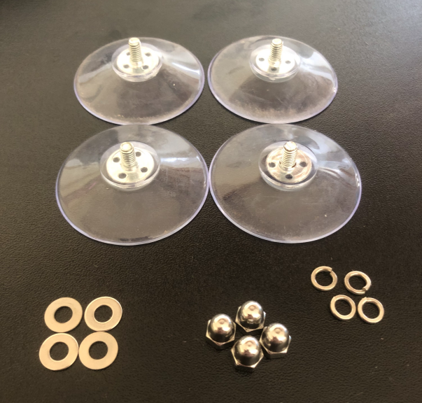
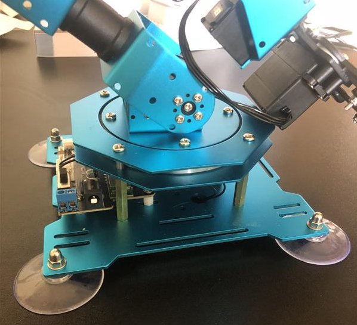
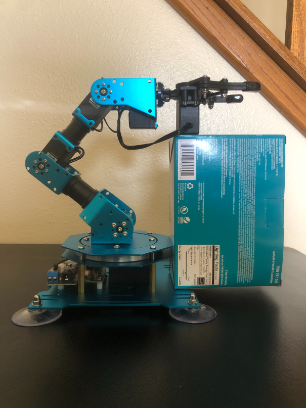
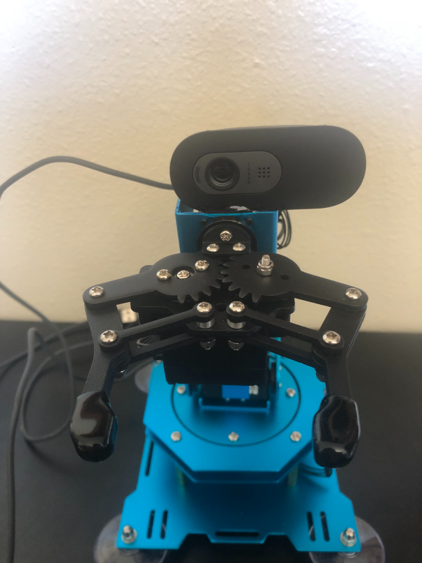
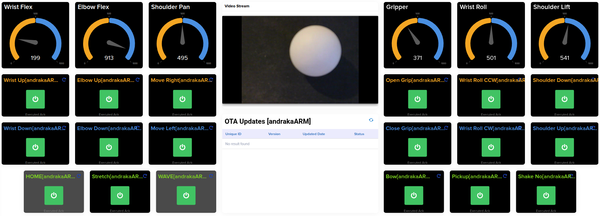

# Renesas RZ/V2H EVK + /IOTCONNECT — XArm YOLO Pick-and-Place

A vision-driven robotic-arm demo for the **Renesas RZ/V2H EVK**: a wrist-mounted
camera finds a ball with a **YOLO model running on the DRP-AI accelerator**, a
Hiwonder xArm 1S picks it up and drops it in a box, and the whole thing streams
telemetry to — and takes commands from — **/IOTCONNECT**.

It is a port of the YOLO pick-and-place demo from
[iotc-tria-vision-ai-kit-robotic-arm](https://github.com/avnet-iotconnect/iotc-tria-vision-ai-kit-robotic-arm)
(Qualcomm QCS6490 / Hexagon NPU) to the RZ/V2H. The control loop, calibration
tools, cloud commands and dashboard are the same; the inference stack is new.

> [!TIP]
> Complete the [/IOTCONNECT quickstart for the RZ/V2H EVK](https://github.com/avnet-iotconnect/iotc-python-lite-sdk-demos/tree/main/renesas-rzv2h-evk)
> first. It covers flashing the SD card, booting the board and onboarding it
> to /IOTCONNECT, and this guide builds on it.

## Contents

1. [How it works on the RZ/V2H](#1-how-it-works-on-the-rzv2h)
2. [Hardware](#2-hardware)
3. [First-time setup](#3-first-time-setup)
4. [Check everything before the arm moves](#4-check-everything-before-the-arm-moves)
5. [Per-site calibration](#5-per-site-calibration)
6. [Running the demo](#6-running-the-demo)
7. [How the pick-and-place works](#7-how-the-pick-and-place-works)
8. [Telemetry and remote commands](#8-telemetry-and-remote-commands)
9. [Other modes and options](#9-other-modes-and-options)
10. [Troubleshooting](#10-troubleshooting)
11. [What changed from the Tria demo](#11-what-changed-from-the-tria-demo)
12. [References](#12-references)

---

## 1. How it works on the RZ/V2H

```
 USB wrist camera ─► OpenCV (V4L2) ─► YOLO ball detector ─► visual-servo control loop ─► xArm 1S (USB HID)
                                       │                     │
                                       │ DRP-AI or CPU       └─► /IOTCONNECT telemetry + commands
                                       ▼
                         HSV box detector (drop target)
```

**Inference.** The RZ/V AI SDK image runs models through the **DRP-AI TVM
runtime** (`libtvm_runtime.so`). Renesas' sample apps drive it from C++; this
demo calls the same runtime from Python through a small `ctypes` binding,
[`detectors/tvm_rt.py`](detectors/tvm_rt.py), so there is nothing to
cross-compile. Any DRP-AI TVM model directory (`deploy.so` / `deploy.json` /
`deploy.params`) can be loaded.

**Which model runs.** The detector takes whatever is installed, in this order:

| Order | Model | Runs on | Detector speed (measured) | Notes |
|---|---|---|---|---|
| 1 | `model/ball_drpai/` — custom YOLOv8n compiled with DRP-AI TVM | **DRP-AI** | not measured yet | Best option. Not in the repo — you compile it, see [CUSTOM_DRPAI_DETECTOR.md](CUSTOM_DRPAI_DETECTOR.md) |
| 2 | `model/ball_best.tflite` — custom YOLOv8n, INT8 | CPU (4× Cortex-A55) | ~105 ms/frame | Bundled. What runs out of the box |
| 3 | Stock COCO YOLOv3 from the AI SDK's R01 app | **DRP-AI** | ~48 ms/frame (38 ms inference) | Already on the SD card. Uses COCO's `sports ball` class |

Why a CPU model outranks a DRP-AI one: accuracy on the actual ball. On 60
wrist-camera validation images that contain the ball, the custom model found it
in 47; the stock COCO model found a "sports ball" in 13. A fast detector that
misses the ball can't pick it up. Compiling the custom model for DRP-AI
(option 1) gets you both, and the demo switches to it automatically once
`model/ball_drpai/` exists.

**Loop rate.** The control loop is slower than the detector alone: every frame
also reads the six servo positions over USB, which costs ~115 ms on this
board. With the arm attached the bundled CPU model runs the loop at **~3.6 fps**
(measured). Against a simulated arm (`yolo_dryrun.py`) the same loop reaches
~8 fps on the CPU model and ~18 fps on the stock DRP-AI model.

To force a specific model: `YOLO_MODEL=/home/weston/R01_object_detection/exe_v2h/yolov3_onnx ./start.sh`.

**Grab distance.** The Tria demo gated the grab on MiDaS monocular depth. The
RZ/V2H image has no depth model, so here the gate uses the ball's **apparent
radius** — a known-size ball gets bigger as the gripper closes in. Depth is
still supported as an option (see [§9](#9-other-modes-and-options)).

**Drop target.** The box is found by HSV colour, exactly as in the Tria demo.

---

## 2. Hardware

### Required

- **Renesas RZ/V2H EVK**, SD card and power supply as described in the
  [quickstart](https://github.com/avnet-iotconnect/iotc-python-lite-sdk-demos/tree/main/renesas-rzv2h-evk)
- **[Hiwonder xArm 1S](https://www.amazon.com/LewanSoul-Programmable-Feedback-Parameter-Programming/dp/B0CHY63V9P?th=1)** — 6-DOF arm + gripper, USB, with its own power supply
- **USB UVC camera** mounted on the wrist. The reference build uses an
  Innomaker U20CAM-1080p; the built-in camera presets are tuned for it
- Ethernet cable
- One practice ball (Nerf Rival rounds work well — small, matte, slightly compressible)
- A drop box in a distinct colour (e.g. blue)

### Optional

- HDMI monitor — the demo shows the annotated camera view on it full screen.
  Not needed: the same view is served to any browser on the LAN
- USB hub — the EVK has few USB-A ports once the arm and camera are plugged in

### Assembly

> [!NOTE]
> This assumes the pre-assembled arm. If yours is a kit, follow Hiwonder's
> assembly instructions first.

1. Attach the suction-cup feet to the base of the arm:

   

   

2. Fix the USB camera to the top of the wrist ("hand") rotation servo, looking
   past the gripper. Epoxy works well; prop the arm on a small box and hold the
   camera with masking tape while it cures.

   

   > [!IMPORTANT]
   > Keep adhesive out of the joints and moving parts.

   

3. Plug the **arm** and the **camera** into the EVK's USB-A ports, power the
   arm from its own supply, and connect Ethernet.

---

## 3. First-time setup

### 3.1 Get the code onto the board

The RZ/V AI SDK image has no `git`, so the repo is pushed from your PC. On the
PC (Linux, macOS, WSL or Git Bash):

```bash
git clone https://github.com/mlamp99/iotc-renesas-rzv2h-robotic-arm.git
cd iotc-renesas-rzv2h-robotic-arm
deploy/push_to_board.sh <board-ip>
```

This copies the repo to `/root/iotc-renesas-rzv2h-robotic-arm` over SSH (root,
no password on the stock image). Re-run it any time to update the board; it
never touches the board's calibration files or /IOTCONNECT credentials.

### 3.2 Install dependencies

On the board, with it online:

```bash
ssh root@<board-ip>
cd /root/iotc-renesas-rzv2h-robotic-arm
bash setup_board.sh
```

[`setup_board.sh`](setup_board.sh) installs the Python packages and then checks
the board. A healthy board ends with:

```
  OpenCV / numpy             OpenCV 4.9.0, numpy 1.26.4
  IOTCONNECT SDK             OK
  LiteRT (CPU fallback)      OK
  xArm                       xArm found on USB
  DRP-AI                     runtime + /dev/drpai0 OK
  USB camera                 /dev/video0 (Innomaker-U20CAM-1080p-S1: Inno)
  ball model                 model/ball_best.tflite (conf 0.5)

All checks passed.
```

> [!IMPORTANT]
> Always install Python packages on this board with `-c constraints.txt`, as
> the script does. The image's OpenCV is built against numpy 1.26; a plain
> `pip install` of almost anything pulls in numpy 2 and `import cv2` stops
> working. Fix: `python3 -m pip install numpy==1.26.4`.

### 3.3 /IOTCONNECT

The demo needs a device whose template declares this demo's telemetry and
commands — the broker silently drops anything a template doesn't declare.

1. In /IOTCONNECT, **Templates → Create Template → Import** and import
   [`robarmv2h-template.json`](robarmv2h-template.json) (template code `robarmV2H`).
2. Give the device that template. Either:
   - **reuse the quickstart device** — open the device, edit its **Template**
     field and pick `robarmV2H`; or
   - **create a new device** with the `robarmV2H` template, following the
     [onboarding guide](https://github.com/avnet-iotconnect/iotc-python-lite-sdk-demos/blob/main/common/general-guides/UI-ONBOARD.md).
     Do this if you want live WebRTC video: the **Stream Resource** must be
     set to **WebRTC** when the device is created and can't be changed later.
3. Put the device's three credential files in the project directory. For the
   quickstart device they are already on the board:

   ```bash
   cp /opt/demo/iotcDeviceConfig.json /opt/demo/device-cert.pem /opt/demo/device-pkey.pem \
      /root/iotc-renesas-rzv2h-robotic-arm/
   ```

> [!NOTE]
> One device identity can only be connected once. Stop the quickstart app in
> `/opt/demo` before starting this demo with the same credentials.

Without the credential files the demo still runs — it just prints a warning
and works with no cloud connection.

### 3.4 Dashboard (optional)



1. In /IOTCONNECT click **Create Dashboard → Import Dashboard** and select
   [`robotic_arm_dashboard_export.json`](robotic_arm_dashboard_export.json).
2. Choose `robarmV2H` as the device template and your device as the device.
3. Save.

The dashboard is shared with the Tria demo. Its GPU and memory-temperature
widgets stay at 0 on the RZ/V2H, which has no such sensors.

---

## 4. Check everything before the arm moves

Three tools exercise the stack with **no arm motion**. Run them in this order
on a new board — each one adds a layer.

```bash
cd /root/iotc-renesas-rzv2h-robotic-arm

# 1. Detector only: one camera frame, all classes, timing
python3 yolo_selftest.py

# 2. The DRP-AI path specifically (stock COCO model)
python3 yolo_selftest.py --model /home/weston/R01_object_detection/exe_v2h/yolov3_onnx

# 3. The real control loop against a SIMULATED arm — the xArm is never opened
python3 yolo_dryrun.py --frames 100 --web-port 8080
```

`yolo_dryrun.py` runs the same mode code the demo runs and reports the frame
rate, how often the ball was seen and what the arm would have been told to do.
Open `http://<board-ip>:8080/` while it runs and put the ball in front of the
camera to see the detection overlay.

---

## 5. Per-site calibration

The arm, the camera and the lighting differ at every site, so a few values
have to be taught. Each tool writes a JSON file next to the code; the demo
loads them at start.

> [!CAUTION]
> The teach tools **release servo torque** so you can pose the arm by hand.
> Support the arm *before* you release it or it will drop.

| File | What it holds | Needed | Tool |
|---|---|---|---|
| `scan_poses.json` | Arm poses the camera sweeps through while searching | When the built-in poses don't suit your table | `./teach.sh` |
| `drop_pose.json` | Arm pose for the drop | Recommended — pick-and-place needs this **or** `box_color.json` | cloud command `teach_drop_pose` |
| `box_color.json` | HSV range of the drop box | Needed without a drop pose (the arm then finds the box by colour). With one, it is optional and only makes the arm ignore balls already in the box | `python3 browser_calibrate.py --output box_color.json`, or cloud command `calibrate target=box` |
| `grab_depth.json` | How big the ball looks at the moment of the grab | Always | `./teach_grab.sh --web-port 8080` |
| `camera_settings.json` | Locked exposure / white balance / saturation | When lighting changes | cloud command `camera_preset <name>` |

**Scan poses** — `./teach.sh`. Pose the arm at each prompted position (near and
far rows, left / centre / right) with the camera looking **down at the table**,
gripper well clear of it, and press `s` + Enter for each. These are search
positions, not grab positions. Keep `wrist_flex` below about 900 so the wrist
has travel left to track with.

**Box colour** — `python3 browser_calibrate.py --output box_color.json`, then
open `http://<board-ip>:8000/`. Release torque, aim the camera at the box,
click on the box a few times to sample its colour, and save.

**Grab reference** — `./teach_grab.sh --web-port 8080`, then open
`http://<board-ip>:8080/`.

1. Hold the arm and press Enter — torque releases.
2. Hand-pose the gripper exactly where it should be when it closes: ball just
   below the jaws, fully visible to the camera.
3. Still holding the arm, press `s` + Enter. It records the ball's median
   radius over 20 frames as `ball_r_at_grab`.
4. `h` + Enter to hold the pose, then `q` + Enter.

The grab gate then fires when the ball looks at least that big (minus
`RADIUS_TOLERANCE`). You can also set it by hand from the cloud:
`set_grab_radius 200`.

**Drop pose** — from /IOTCONNECT send `release_torque`, hand-pose the gripper
above the box, send `hold_pose`, then `teach_drop_pose`.

**Camera** — a camera left on auto-exposure drifts, and yesterday's colour
calibration stops matching. Send `camera_preset normal` (or `bright`, `dim`,
`vivid`, `warm`, `cool`) to lock it; tune individual values with
`camera_setting <name> <value>` and keep the result with
`camera_preset_save <name>`.

---

## 6. Running the demo

> [!CAUTION]
> At start-up the arm drives to its home pose, and in a vision mode it starts
> scanning straight away. Clear the workspace first.

```bash
ssh root@<board-ip>
cd /root/iotc-renesas-rzv2h-robotic-arm
./start.sh --web-port 8080
```

The annotated camera view opens **full screen on the HDMI monitor** — from an
SSH or serial shell too, since `start.sh` attaches to the board's Weston
display itself — and is served at `http://<board-ip>:8080/`. The log goes to
the terminal and to `run.log`.

Useful variations:

```bash
./start.sh --mode idle --web-port 8080          # connect to the cloud, don't run vision until told
./start.sh --mode yolo-ball --web-port 8080     # find and grab only, no drop
./start.sh --webrtc --web-port 8080             # + live video in the /IOTCONNECT portal (§9)
./start.sh --headless --web-port 8080           # browser view only, nothing on HDMI
YOLO_CONF=0.3 ./start.sh --web-port 8080        # override the detection confidence
YOLO_CPU=1 ./start.sh --web-port 8080           # never use DRP-AI models
```

**Without the cloud.** [`yolo_pickplace.py`](yolo_pickplace.py) is the same
pick-and-place with no /IOTCONNECT in the loop and model options on the
command line — handy for trying a model or a threshold:

```bash
./start_yolo.sh --web-port 8080 --conf 0.4
./start_yolo.sh --web-port 8080 --model /home/weston/R01_object_detection/exe_v2h/yolov3_onnx
```

**Expected start-up log:**

```
[yolo] model=ball_best.tflite format=yolov8 nc=1 in=640x640 backend=CPU (LiteRT/XNNPACK, 4 threads)
[yolo-ball] grab gate ARMED: ...
[yolo-pickplace] entering BALL_PHASE ...
```

With a DRP-AI model the first line ends `backend=DRP-AI (TVM runtime)`.

**Live overlay during a pick:**

```
r=152 dx=+4 dy=-122                                   ← ball radius + pan/tilt error in px
center=OK  settle 2/3  [both] D->=750 r+>=180         ← grab gate state
DRP-AI: yolo=48.0ms  18 fps                           ← backend, inference time, loop rate
```

### Start at boot

```bash
sh deploy/install_service.sh
```

installs `robotarm.service`, which runs [`deploy/arm_watchdog.sh`](deploy/arm_watchdog.sh).
The watchdog launches the app in **idle** and relaunches it if the arm
re-enumerates on USB or the app dies. Start and stop the pick-and-place from
the cloud with `set_mode mode=yolo-pickplace` and `set_mode mode=idle`.

Pause it while you calibrate over SSH: `touch /tmp/demo_watchdog_off`
(resume: `rm /tmp/demo_watchdog_off`).

---

## 7. How the pick-and-place works

### States

| State | What it does | Leaves when |
|---|---|---|
| `BOX_SEEK` / `BOX_LOCKING` | Finds the box by colour and records the pose (skipped when `drop_pose.json` exists) | Box pose known |
| `BALL_PHASE` → `SCANNING` | Cycles through the scan poses so the camera sweeps the table | Ball detected |
| `TRACKING` | P-controller drives `shoulder_pan` and `wrist_flex` to centre the ball, then steps the arm toward it | Centred and close enough |
| `GRABBING` | Closes the gripper, waits for the jaws to stall on the ball, lifts, checks it didn't slip | Ball held (or retry) |
| `TRANSPORT` → `DROPPING` → `HOMING` | Carries the ball to the box, opens, returns | Back at `BALL_PHASE` |

Balls already inside the box footprint are ignored, so the arm doesn't pick
its own drops back up.

### Grab gate

The grab fires when the ball is **centred** and the gate has held for
`DEPTH_SETTLE_FRAMES` consecutive frames. The gate is live-settable from the
cloud:

| Command | Effect |
|---|---|
| `set_grab_gate radius` \| `depth` \| `both` | Which signal(s) must agree. With no depth model installed every mode behaves as `radius` |
| `set_grab_radius <px>` \| `auto` | Radius target. `auto` = the taught `ball_r_at_grab` |
| `set_grab_threshold <D>` | Depth floor (only with a depth model) |
| `grab_threshold_show` / `grab_threshold_reset` | Read back / restore defaults |

### Tuning constants

Control-loop constants live at the top of [`modes/ball_follow.py`](modes/ball_follow.py)
and [`modes/yolo_pickplace.py`](modes/yolo_pickplace.py); each has a comment
explaining what it does and how it was arrived at. The ones most likely to need
attention on a new build:

| Constant | Default | Notes |
|---|---|---|
| `PAN_DIR`, `TILT_DIR` | 1, -1 | Sign of the correction. Flip one if the arm steers *away* from the ball |
| `PAN_GAIN`, `TILT_GAIN` | 0.04, 0.10 | Servo units per pixel of error |
| `MIN_TRIM_STEP`, `MIN_TRIM_STEP_PAN` | 14, 18 | Smallest command that beats servo static friction |
| `CENTER_DEADBAND_PX` | 60 | Pixel error treated as "centred" |
| `TARGET_RADIUS_PX`, `RADIUS_TOLERANCE` | 220, 40 | Fallback grab radius when nothing has been taught |
| `LIFT_MAX`, `ELBOW_MAX` | 800, 500 | Ceilings that stop the approach before the gripper reaches the table |
| `NO_BALL_GRACE_FRAMES` | 30 | Lost-ball frames tolerated before going back to scanning |
| `PAN_COOLDOWN_MS` | 250 | Minimum gap between pan corrections |

> [!NOTE]
> Several of these are counted in **frames**, and the defaults were tuned on
> the Tria at ~14 fps. This board runs the loop at ~3.6 fps with the bundled
> CPU model, so frame-counted behaviour (grace periods, settle time) takes
> about four times longer. Re-tune if tracking feels sluggish.

---

## 8. Telemetry and remote commands

### Telemetry

Sent every ~5 s and after each grab.

| Field | Description |
|---|---|
| `state` | Current state, e.g. `BALL:TRACKING`, `TRANSPORT` |
| `gripper`, `wrist_roll`, `wrist_flex`, `elbow_flex`, `shoulder_lift`, `shoulder_pan` | Servo positions (0–1000) |
| `sysInfo_system`, `sysInfo_cpu`, `sysInfo_memory`, `sysInfo_storage` | Host, CPU load + temperature, RAM, disk |
| `sysInfo_gpu`, `sysInfo_memory.temp` | Always 0 on the RZ/V2H; kept for dashboard compatibility |
| `ballTrack.backend` | Where YOLO ran: `DRP-AI` or `CPU` |
| `ballTrack.yolo_ms`, `ballTrack.npu_fps` | Inference time and loop rate |
| `ballTrack.ball_x`, `ball_y`, `ball_r` | Last detection, pixels |
| `ballTrack.pan_err`, `tilt_err`, `radius_err` | Control errors |
| `ballTrack.d_pan`, `d_tilt`, `d_lift`, `d_elbow` | Last commanded servo deltas |
| `ballTrack.gate_mode`, `r_target`, `D_threshold`, `depth_settle` | Grab-gate configuration and state |
| `ballTrack.depth_ms`, `depth_at_ball`, `depth_at_ball_smoothed`, `D_grab`, `D_tolerance` | Depth values (0 without a depth model) |

### Commands

| Command | Effect |
|---|---|
| `set_mode mode=<name>` | Switch mode without restarting: `yolo-pickplace`, `yolo-ball`, `pickplace`, `ball`, `idle` |
| `stop_demo` | Same as `set_mode mode=idle` |
| `move_to_home`, `open_gripper`, `close_gripper` | Basic arm moves |
| `move_forward` / `move_backward` / `move_left` / `move_right` / `move_up` / `move_down` | Jog the arm |
| `wrist_flex_up` / `wrist_flex_down` / `wrist_roll_cw` / `wrist_roll_ccw` | Jog the wrist |
| `demo_wave`, `demo_bow`, `demo_scan`, `demo_pickup`, `demo_stretch`, `demo_shake_no` | Canned motion sequences |
| `release_torque` / `hold_pose` | Drop / re-engage servo torque for hand-posing |
| `teach_scan_pose name=<n>`, `scan_poses_show`, `scan_poses_reset` | Manage scan poses |
| `teach_drop_pose`, `drop_pose_show`, `drop_pose_reset` | Manage the drop pose |
| `calibrate target=<ball\|box\|offset\|grab_depth>` | Start a browser calibrator at `http://<board-ip>:8000/` |
| `stop_calibration` | Stop the calibrator and resume |
| `set_grab_gate`, `set_grab_radius`, `set_grab_threshold`, `grab_threshold_show`, `grab_threshold_reset` | Grab gate, see [§7](#grab-gate) |
| `camera_setting <name> <value>`, `camera_settings_show`, `camera_settings_reset` | Camera controls |
| `camera_preset <name>`, `camera_preset_save <name>`, `camera_presets_show` | Camera presets |

---

## 9. Other modes and options

### HSV modes (no neural network)

`--mode ball` and `--mode pickplace` are the classical-CV versions: the ball is
found by HSV colour instead of YOLO. They need `ball_color.json`
(`python3 browser_calibrate.py --output ball_color.json`) and are a useful
baseline — fast, but sensitive to lighting.

### Live WebRTC video in the /IOTCONNECT portal

```bash
bash setup_board.sh --webrtc      # one time: installs aiortc, websockets, boto3
./start.sh --webrtc --web-port 8080
```

The device must have been **created** with the `robarmV2H` template and
**Stream Resource = WebRTC** (see [§3.3](#33-iotconnect)).

> [!NOTE]
> The WebRTC code is unchanged from the Tria demo and its dependencies resolve
> on this board, but streaming has not been tested on the RZ/V2H yet.

### Custom model on DRP-AI

[CUSTOM_DRPAI_DETECTOR.md](CUSTOM_DRPAI_DETECTOR.md) covers training a model on
your own ball and compiling it for DRP-AI with Renesas' DRP-AI TVM. The result
goes in `model/ball_drpai/` and is picked up automatically.

### Depth-gated grab

Install a MiDaS depth model as `model/midas_drpai/` (DRP-AI TVM model
directory) or `model/midas.tflite` (CPU) and the demo loads it, shows `D=` at
the ball and lets the grab gate use it (`set_grab_gate both`). Re-run
`./teach_grab.sh` afterwards so `D_grab` is recorded. No depth model ships for
this board; the radius gate does not need one.

---

## 10. Troubleshooting

| Symptom | Cause and fix |
|---|---|
| `ImportError: numpy.core.multiarray failed to import` | A `pip install` upgraded numpy to 2.x. `python3 -m pip install numpy==1.26.4`, and always install with `-c constraints.txt` |
| `could not open the xArm over USB` | Arm unpowered or unplugged (`python3 list_usb.py` should list `0483:5750`), or another process has it — stop the other demo or `touch /tmp/demo_watchdog_off` |
| No `/dev/hidraw*` | Expected. This kernel has no hidraw; the arm is driven through libusb by the `hidapi` wheel |
| Camera opens but exposure / saturation commands do nothing | Something opened the camera with OpenCV's default GStreamer backend. Use `camera_settings.open_capture()`, which selects V4L2 |
| ~15 fps camera instead of 30 | Same cause — the V4L2 backend needs the frame rate requested, which `open_capture()` does |
| Demo runs on `backend=CPU` | No DRP-AI ball model installed; that is the default. See [§1](#1-how-it-works-on-the-rzv2h) |
| TVM error when a mode starts | Another process is using DRP-AI (a Renesas HDMI demo, a second copy of this app), or the model was compiled with a different DRP-AI TVM version than the board's `libtvm_runtime.so` |
| Ball visible but never detected | Check `python3 yolo_selftest.py` with the ball in view. Lower the threshold (`YOLO_CONF=0.3`); if it still fails, the ball or lighting differs from the training set — retrain ([CUSTOM_DRPAI_DETECTOR.md](CUSTOM_DRPAI_DETECTOR.md)) |
| Arm tracks but never grabs | The gate isn't satisfied: read the gate line in the overlay, then re-teach with `./teach_grab.sh` or send `set_grab_radius <px>` |
| Arm steers away from the ball | `PAN_DIR` / `TILT_DIR` sign is wrong for your mounting |
| `pick-and-place needs a drop target` | Neither a drop pose nor a box colour has been taught ([§5](#5-per-site-calibration)). The app drops back to idle and stays connected; teach one and send `set_mode` again |
| A mode fails to start | The reason is printed as `[supervisor] mode '<name>' failed: …`. The app returns to idle with the arm holding and /IOTCONNECT connected |
| Telemetry missing in /IOTCONNECT | The device isn't on the `robarmV2H` template — undeclared attributes are dropped silently |
| No preview window on HDMI | Weston must be running (`systemctl status weston`) with a monitor connected; `start.sh` attaches to it through `deploy/display_env.sh`. The calibrators with an OpenCV window need `./launch_gui.sh <tool>` |

---

## 11. What changed from the Tria demo

| | Tria Vision AI Kit 6490 | Renesas RZ/V2H EVK |
|---|---|---|
| Accelerator | Hexagon NPU, TFLite + QNN delegate | DRP-AI, DRP-AI TVM runtime via `detectors/tvm_rt.py` |
| Custom model format | INT8 TFLite | DRP-AI TVM model directory (compiled from ONNX); INT8 TFLite on the CPU as fallback |
| Stock model | YOLO-X (COCO) | YOLOv3 (COCO), from the AI SDK R01 app |
| Depth | MiDaS on the NPU, bundled | Optional; none bundled. Grab gate uses ball radius |
| Arm USB | hidraw | libusb (kernel has no hidraw) |
| Camera capture | OpenCV default backend | OpenCV V4L2 backend, selected explicitly |
| Python env | conda | System Python 3.12, numpy pinned |
| Getting code on the board | `git clone` | `deploy/push_to_board.sh` (no git on the image) |
| Modes | asl, ball, pickplace, yolo-ball, yolo-pickplace | ball, pickplace, yolo-ball, yolo-pickplace (ASL needs torch + MediaPipe, not ported) |
| Device template | `robarmRTC` | `robarmV2H` (adds `ballTrack.backend` and the grab-gate fields and commands) |

---

## 12. References

### Renesas RZ/V2H
- [RZ/V2H EVK /IOTCONNECT quickstart](https://github.com/avnet-iotconnect/iotc-python-lite-sdk-demos/tree/main/renesas-rzv2h-evk)
- [RZ/V2H AI SDK getting started](https://renesas-rz.github.io/rzv_ai_sdk/latest/getting_started_v2h.html)
- [DRP-AI TVM](https://github.com/renesas-rz/rzv_drp-ai_tvm) — compiler and runtime for DRP-AI
- [RZ/V AI applications](https://github.com/renesas-rz/rzv_ai_sdk) — source of the stock R01 object-detection model

### /IOTCONNECT
- [/IOTCONNECT Python Lite SDK](https://github.com/avnet-iotconnect/iotc-python-lite-sdk)
- [Device onboarding guide](https://github.com/avnet-iotconnect/iotc-python-lite-sdk-demos/blob/main/common/general-guides/UI-ONBOARD.md)
- [/IOTCONNECT platform](https://www.iotconnect.io/)

### Robotics and AI
- [Tria Vision AI Kit version of this demo](https://github.com/avnet-iotconnect/iotc-tria-vision-ai-kit-robotic-arm)
- [xarm Python library](https://pypi.org/project/xarm/) — Hiwonder xArm 1S over USB HID
- [Ultralytics YOLOv8](https://docs.ultralytics.com/)
